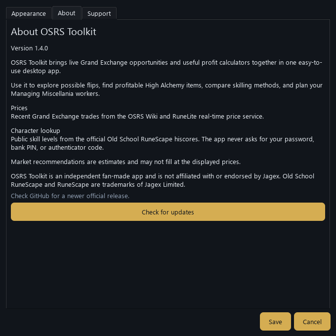

# OSRS Toolkit

A Windows desktop companion for Grand Exchange analysis, automatic RuneLite trade tracking,
High Alchemy, skilling profit, and Managing Miscellania.

## Download

### **[Download the latest release](https://github.com/Wolklaw/OSRS-Toolkit/releases/latest)**

Choose one file:

- **Setup `.exe` — recommended:** guided installation, Start Menu entry, optional desktop
  shortcut, uninstaller, and in-app updates.
- **Portable `.zip`:** extract it anywhere and open `OSRS Toolkit.exe`. Nothing is installed.

Python, PowerShell, and developer tools are not required. Windows may show an **Unknown
publisher** warning because the application is not currently code-signed.

## Quick start

1. Install the app or extract the portable ZIP.
2. Open **OSRS Toolkit**. Current market prices load automatically.
3. Enter the amount of GP you want to use in **Cash stack**.
4. Set **GE slots** to the number of offers you can use.
5. Choose **Quick**, **Balanced**, or **Overnight** based on how long you want offers to sit.
6. Read the suggested buy price, sell price, quantity, estimated profit, and confidence before
   placing anything in the Grand Exchange.

The cash stack affects quantities and rankings immediately. Select **Update prices** whenever you
want a fresh market snapshot.

## Using the GE Flipper

The recommendation panel allocates one cash stack across up to the selected number of GE slots.
It evaluates the complete offer mix by total profit, confidence, usable capital, and available
slots rather than blindly taking the first ranked rows. It shows total GP allocated and GP held
back. Cash is held back when no additional quantity passes the current liquidity, buy-limit, and
risk caps; the app does not force weak trades just to spend every coin. The **BUY** and **THEN
SELL** targets are patient limit offers based on recent trades—not guaranteed instant prices.

Targets cross-check the latest trade with five-minute and one-hour averages. A spread must also
have meaningful completed-trade volume on both sides, preventing a single unusual trade from
appearing as an enormous margin.

Each result includes:

- **Buy / Sell:** suggested offer prices.
- **Safe max:** the maximum size the item passes on its own based on cash, volume, and GE limit.
- **Profit ea. / Max potential:** estimated profit after Grand Exchange tax at that safe maximum.
- **ROI:** estimated return relative to the buy price.
- **1h volume:** recent market activity.
- **Confidence:** a market-quality estimate based on liquidity, freshness, and stability.

Double-click any item for its full price breakdown. Use **Track all recommended offers** to preserve
the complete portfolio in the Trade Journal before market prices change.

No recommendation is a guaranteed trade. Start with small quantities and confirm that an item is
actually filling near the displayed prices before committing more GP.

## Tracking a trade

When you track a recommendation, it begins as **Pending buy** with the original quantity and
targets saved. As the trade progresses:

1. Select the journal row.
2. Choose **Update selected trade**.
3. Change its status to **Bought**, **Listed for sale**, **Completed**, or **Cancelled**.
4. Enter the actual prices you received.

Only completed trades count toward realized profit, win rate, and capital traded. You can also add
a completed trade manually.

## Connecting RuneLite

Install and enable **OSRS Toolkit Sync** in RuneLite, then choose **Connect RuneLite** in the
toolkit's top bar. The status changes to **RuneLite connected** while the plugin heartbeat is
active. The plugin source and installation information are available in the
[OSRS Toolkit Sync repository](https://github.com/Wolklaw/osrs-toolkit-runelite).

Grand Exchange fills are written to a durable local queue while RuneLite is running. The toolkit
imports them into **Trade Journal → RuneLite activity** every few seconds, including fills made
while the desktop app was closed. Imported event IDs are idempotent, so retrying a temporary file
or database failure does not duplicate the trade.

Player-to-player trade tracking is optional and disabled by default in the RuneLite plugin
settings. When enabled, only completed trades are recorded, including the other player's display
name and the exact items and coins given and received. This information stays on your computer.

The plugin cannot reconstruct trades made before it was installed, while it was disabled, or from
mobile and other game clients.

## Finding High Alchemy candidates

The Alch Finder compares an item's High Alchemy value with a conservative acquisition cost. The
**Safe buy** is the highest of the latest buyer-paid trade, five-minute average, and one-hour
average—not an advertised offer currently waiting in the Grand Exchange. Safety modes also reject
stale or thinly traded items and cap suggested quantities by budget, volume, buy limit, and the
1,200-cast hourly maximum.

## Comparing skilling profit

Skilling Profit compares more than 80 processing and gathering activities across Cooking,
Crafting, Fishing, Fletching, Herblore, Hunter, Magic, Mining, Smithing, and Woodcutting. Inputs use
conservative buyer-paid prices; outputs use conservative seller-received prices after Grand
Exchange tax. Search and skill filters make the catalogue easier to scan, and a connected character
can hide methods above the player's public skill levels.

Action and gathering rates are practical baselines. Cooking rows assume no burned food; gathering
varies with location, gear, competition, and attention. Specialised tools, risk, or staff assumptions
are shown in the table. Always test supplies and output sales in small amounts.

## Other tools

- **Watchlist:** double-click supported market rows to save items for later monitoring.
- **Kingdom Optimizer:** compares Managing Miscellania resources using current market prices.
- **Character lookup:** enter only a public RuneScape display name. This reads public OSRS hiscores
  and does not log into your account.

## Updating the app

Open **Settings → About → Check for updates**. When a newer version exists, OSRS Toolkit downloads
the official GitHub installer, verifies its SHA-256 digest, opens the installer, and closes the old
version.

The portable edition cannot replace itself while running. Its update button installs the standard
edition and leaves the old portable folder unchanged.

## Market data and privacy

Prices come from the OSRS Wiki/RuneLite real-time price API. Settings, cached prices, watchlists,
and journal entries remain on your computer.

OSRS Toolkit never asks for or stores your Jagex password, bank PIN, authenticator code, or game
session credentials.

Grand Exchange prices can move, offers may not fill, and unusual trades can temporarily distort
market data. Recommendations are estimates—not guaranteed profit.

## License

OSRS Toolkit is available under the [GNU General Public License v3.0](LICENSE).

This project is not affiliated with or endorsed by Jagex. Old School RuneScape and RuneScape are
trademarks of Jagex Limited.
