

# OSRS Toolkit

### Plan better trades. Record what actually happened.

A free Windows desktop companion for Grand Exchange research, slot-aware flip planning,
trade journaling, optional RuneLite imports, High Alchemy, skilling margins, and Managing
Miscellania.

### [Download the latest Windows release](https://github.com/Wolklaw/OSRS-Toolkit/releases/latest)

**No login. No game automation. Your journal stays on your PC.**

[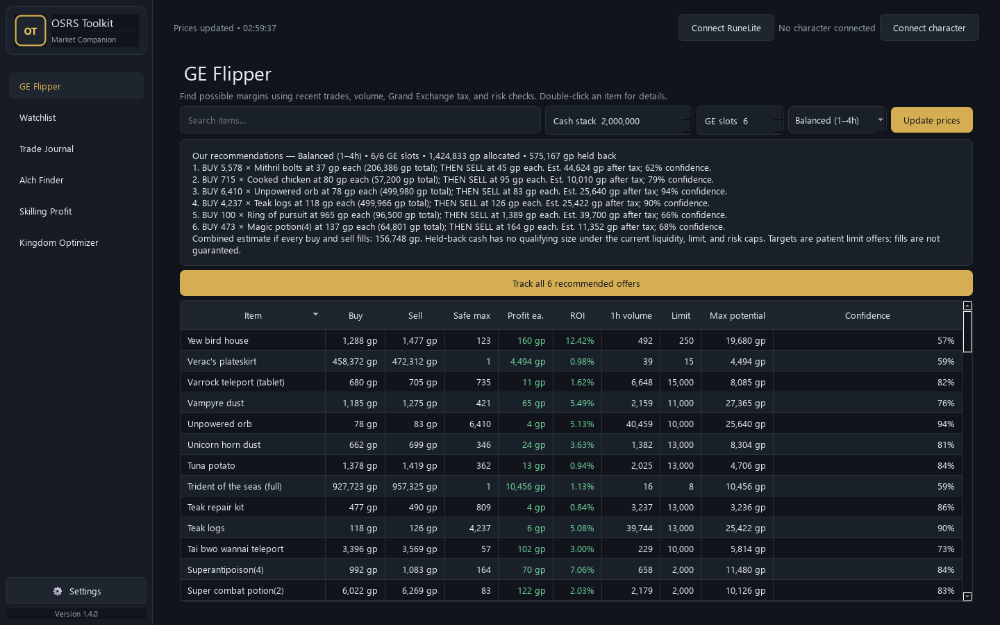](docs/images/ge-flipper.png)

## One toolkit, six connected workflows

| | |
|---|---|
| **GE Flipper** — Build a complete offer portfolio around your cash, available GE slots, liquidity, limits, and preferred time horizon. | **Watchlist** — Keep saved items together with passive targets, after-tax margin, ROI, volume, and trade age. |
| **Trade Journal** — Preserve original targets, record partial sales at every real price, and calculate tax-correct realized P/L. | **RuneLite activity** — Import locally queued GE fills and optional completed player trades from the companion plugin. |
| **Alch Finder** — Compare conservative acquisition costs with High Alchemy value, nature-rune cost, liquidity, and budget. | **Skilling & Kingdom** — Compare 83 skilling methods across 10 skills and optimize Managing Miscellania workers with current market data. |

Every market-dependent page uses the same shared data source. The app fetches market data in the
background on launch and every five minutes; **Refresh market** forces an immediate fetch without
freezing the interface, then updates every open calculation together.

## Download

The [latest release](https://github.com/Wolklaw/OSRS-Toolkit/releases/latest) contains two builds:

| Build | Best for | What you get |
|---|---|---|
| **Setup `.exe` — recommended** | Most players | Guided install, Start Menu entry, optional desktop shortcut, uninstaller, and in-app updates. |
| **Portable `.zip`** | A folder or USB drive | Extract anywhere and open `OSRS Toolkit.exe`; nothing is installed. |

Python, PowerShell, and developer tools are not required. Releases are not currently code-signed,
so Windows may display an **Unknown publisher** warning. Download only from this repository's
official Releases page.

## GE Flipper

Enter a cash stack, choose **1–8 available GE slots**, and select **Quick**, **Balanced**, or
**Overnight**. OSRS Toolkit evaluates the offer mix as a whole instead of simply taking the first
rows in a ranking.

- Sizes positions around available cash, slot count, four-hour buy limits, recent volume, and
  strategy-specific risk caps.
- Cross-checks the latest completed trades with five-minute and one-hour averages.
- Rejects stale prices, one-sided liquidity, excessive drift, weak ROI, and margins too small for
  the selected strategy's adverse-price buffer.
- Shows suggested buy/sell offers, safe maximum, after-tax profit, ROI, one-hour volume, buy limit,
  maximum potential, and a market-quality confidence score.
- Reports exactly how much GP is allocated or held back. Held-back GP means no additional size
  passed the current liquidity, limit, and risk rules.
- Opens a complete price breakdown on double-click and can track one offer—or the full recommended
  portfolio—directly in the journal.

[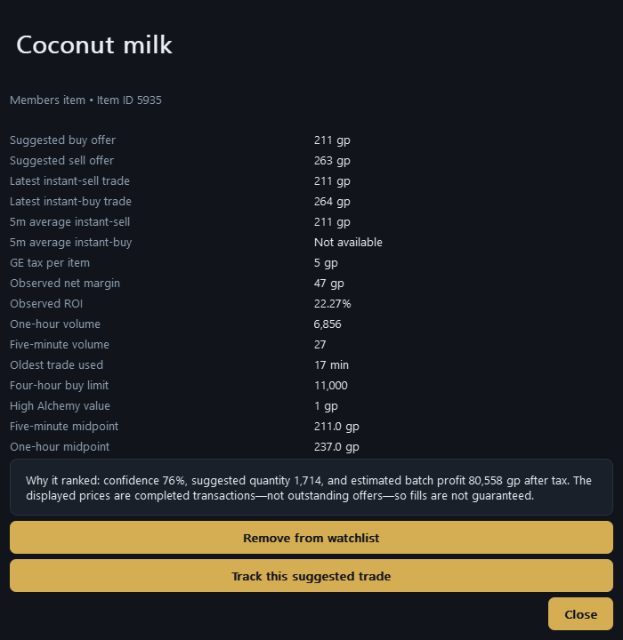](docs/images/item-details.png)

The displayed prices are completed transactions, not outstanding GE offers. Confidence describes
the quality of the underlying data; it is not a promise that an offer will fill or make money.

## Watchlist

[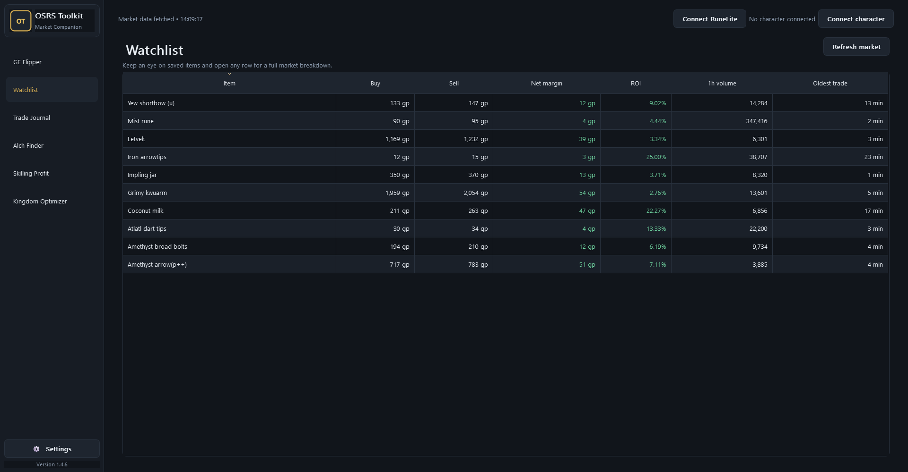](docs/images/watchlist.png)

Open an item from GE Flipper or Alch Finder to add it to the persistent watchlist. Double-click a
saved row for its full latest, five-minute, and one-hour breakdown, or remove it from the same item
view.

## Trade Journal

[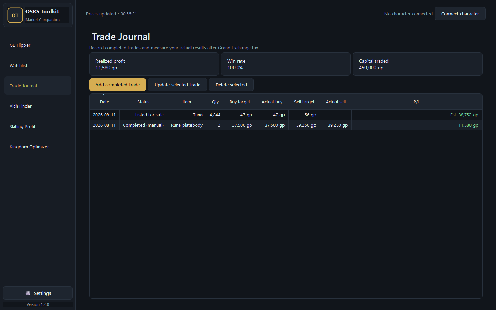](docs/images/trade-journal.png)

Recommendations enter the journal as **Pending buy** with their original quantity, strategy, and
targets preserved. A position can move through **Bought**, **Listed for sale**, **Partially sold**,
**Completed**, or **Cancelled**.

- Record the actual buy price and any number of sale fills at different quantities and prices.
- See the weighted-average sale price, remaining quantity, and tax-correct realized result.
- Scan color-coded lifecycle states and filter the table to active trades or any individual status.
- Distinguish clearly labeled projections from signed, color-coded realized profit and loss.
- Keep original suggestions beside actual execution data, even after the market changes.
- Double-click any tracked row to update it; completed trades can also be entered manually.
- Review realized profit, win rate, and capital traded at a glance.
- Overnight positions keep their original targets while current suggestions are reviewed once on
  each new day when sufficiently fresh market data is available.

[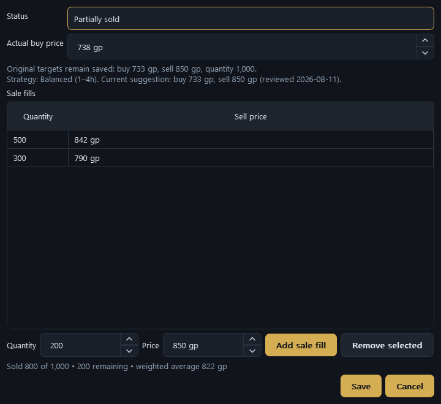](docs/images/trade-sale-fills.png)

Journal statistics use trades with realized sale proceeds, including partially sold positions.
Cancelled positions with no realized sale are excluded from win rate.

The journal uses a version-independent local database. Startup backups retain the latest ten
copies, and recovery logic can migrate data from older storage locations after an update.

## RuneLite activity

Install and enable the separate
[OSRS Toolkit Sync companion plugin](https://github.com/Wolklaw/osrs-toolkit-runelite), then choose
**Connect RuneLite**. Partial and completed GE fills are queued locally while RuneLite is running,
including while the desktop app is closed, and imported automatically when the toolkit opens.

[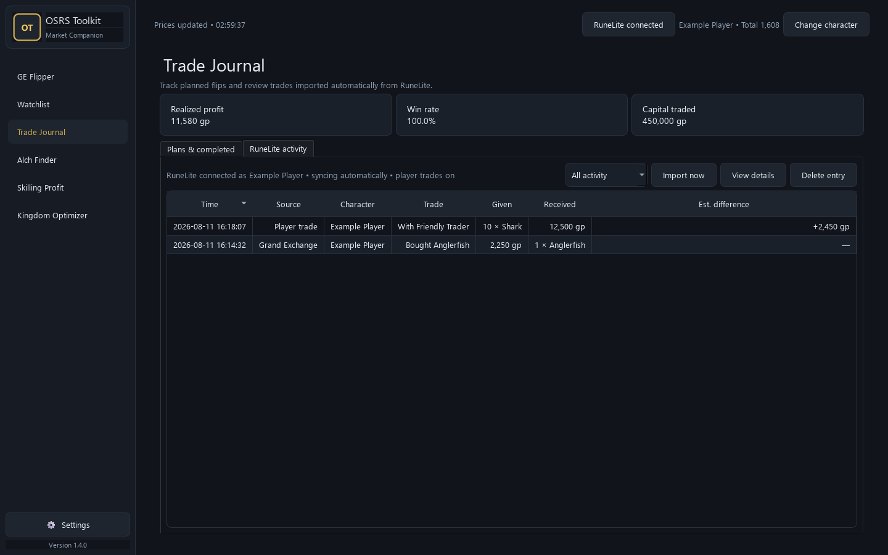](docs/images/runelite-activity.png)

- Durable local queue with idempotent event IDs, so retries do not duplicate an import.
- Character, buy/sell side, item, quantity, coins, offer slot, limit price, and offer state.
- Filters for all activity, Grand Exchange fills, or player trades, with details and deletion.
- Optional player-to-player tracking is **off by default** and records completed trades only.
- Active/offline heartbeat and automatic public-hiscore lookup for the connected character.

[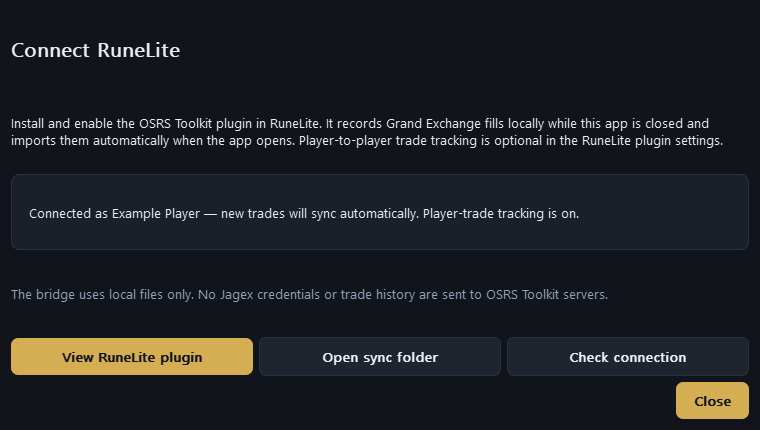](docs/images/runelite-connection.png)

The bridge uses local files. It does not automate clicks, alter offers, communicate with game
worlds, request Jagex credentials, or upload trade history to an OSRS Toolkit server. It cannot
reconstruct trades made before installation, while disabled, or through mobile and other clients.

## Alch Finder

[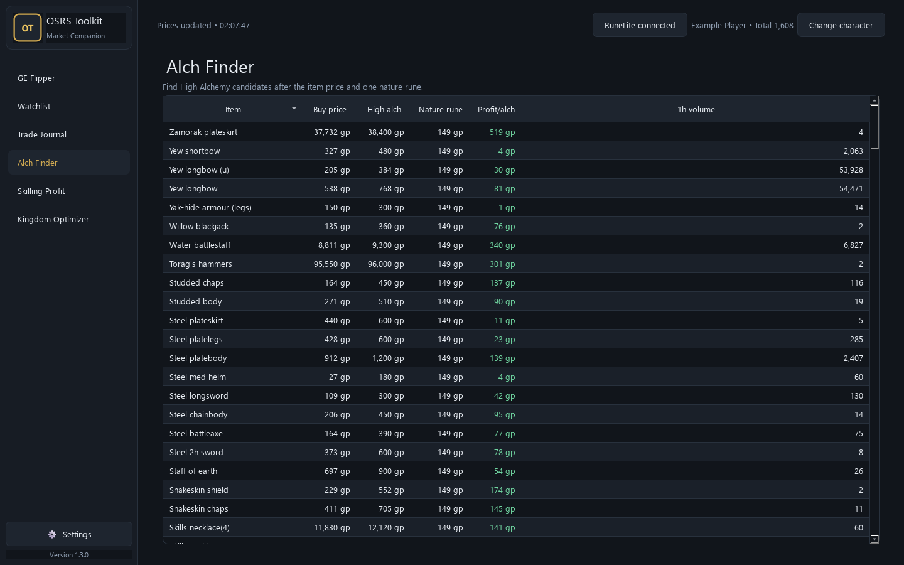](docs/images/alch-finder.png)

Alch Finder uses the highest recent buyer-paid observation across the latest, five-minute, and
one-hour data, then includes the current nature-rune cost. **Safer**, **Balanced**, and **Show all**
policies constrain results by trade age and liquidity. Suggested quantity is capped by budget,
hourly volume share, GE buy limit, and the 1,200-cast hourly maximum.

High Level Alchemy requires Magic level 55. Every listed candidate shares that requirement, so the
table does not waste space on a redundant Magic 55 column.

## Skilling Profit

[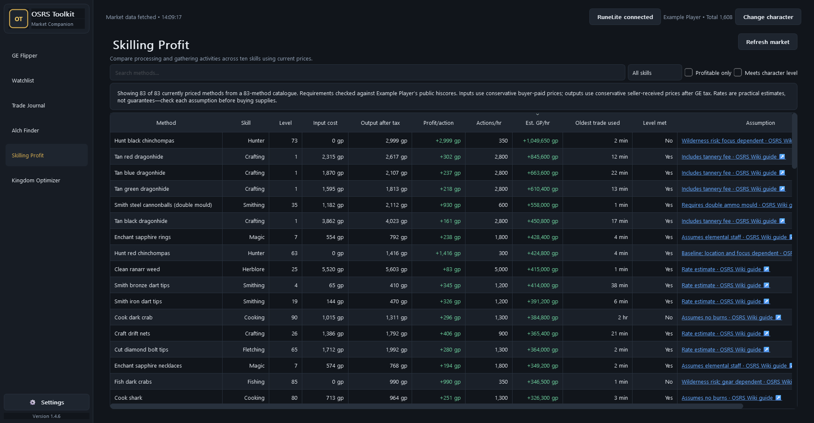](docs/images/skilling-profit.png)

Compare **83 processing and gathering methods across 10 skills**: Cooking, Crafting, Fishing,
Fletching, Herblore, Hunter, Magic, Mining, Smithing, and Woodcutting.

- Search by method, filter by skill, show profitable methods only, or connect a character to hide
  methods above its public hiscore levels.
- Inputs use conservative buyer-paid prices; outputs use conservative seller-received prices after
  Grand Exchange tax.
- Compare input cost, output value, profit per action, practical actions per hour, estimated GP per
  hour, requirement level, and the oldest completed trade used in the calculation.
- Every assumption links to a verified, relevant OSRS Wiki training guide.
- Notes call out burn assumptions, fixed fees, staff/tool requirements, Wilderness risk, and
  route-, gear-, competition-, or attention-dependent rates.

Rates are practical baselines, not guarantees. Test supply purchases and output sales in small
amounts before committing a large stack.

## Kingdom Optimizer

[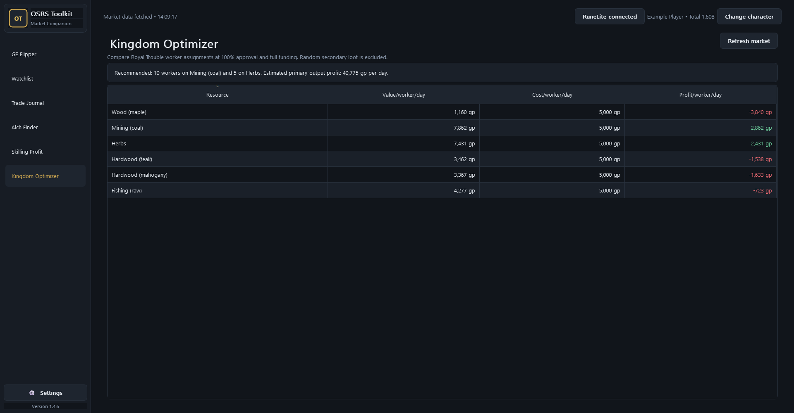](docs/images/kingdom-optimizer.png)

Compare coal, maple, teak, mahogany, raw fish, and herbs, then get a suggested 10-worker/5-worker
split. Calculations assume **Royal Trouble completed, 100% approval, and full funding**. They use
current seller-received prices after GE tax and deliberately exclude random secondary loot.

## Market data: fetch time vs. trade age

**Market data fetched • 14:03:03** means the app successfully downloaded the newest response from
the OSRS Wiki price API at that time. It does not mean every item traded at 14:03:03.

Illiquid items may not have a new completed trade for 30 minutes, two hours, or longer. The
**Oldest trade**, **Buy trade age**, and **Oldest trade used** columns expose the age of the actual
observations behind each result. For a skilling method, the displayed age is the oldest required
input or output trade. A freshly fetched response can therefore—and honestly—contain older item
prices.

Market data is loaded once and shared across every page. A manual fetch disables all refresh
buttons until it finishes, keeps the UI responsive, and rerenders the current page automatically.
If the API is temporarily unavailable, the app can fall back to its last local cache and labels it
**Cached market data loaded**.

## Daily-use details

- **Sign-aware money:** positive results are green, true losses are red, and zero is neutral.
  Ordinary input costs are not mislabeled as losses.
- **Responsive tables:** columns fill wide windows and preserve readable minimums with smooth
  horizontal scrolling in compact windows; cells remain sortable, right-aligned, and tooltiped.
- **Purpose-built controls:** consistent buttons, fields, dropdowns, checkboxes, focus states,
  disabled states, hit areas, and dark-theme scrollbars.
- **Search that behaves normally:** clear button when populated, Escape to clear, and standard
  selection/copy/paste shortcuts.
- **Three saved themes:** Dark, Midnight, and Light.
- **Public character lookup:** enter only a RuneScape display name to show total level and filter
  skilling methods. The toolkit never logs into the account.

## Updates, privacy, and game boundaries

[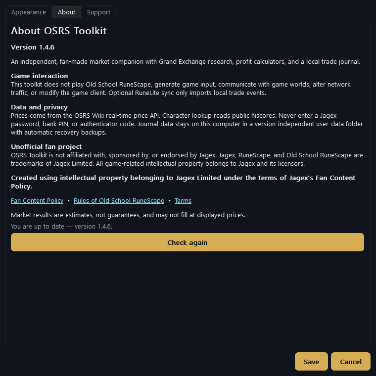](docs/images/settings-about.png)

Installed copies can check the official GitHub release from **Settings → About**, download its
installer, verify the GitHub-provided SHA-256 digest, and open it. Portable copies install the
standard edition and leave the portable folder unchanged.

Journal entries, imported trade history, settings, watchlists, and cached prices remain in local
user-data folders. Market fetches use the OSRS Wiki API, update checks use GitHub Releases, and
character lookup reads public OSRS hiscores. OSRS Toolkit never asks for or stores a Jagex
password, bank PIN, authenticator code, or game session credential. See the
[security policy](SECURITY.md) for safe reporting.

## Quick start

1. Install the app or extract the portable ZIP.
2. Open **OSRS Toolkit**; market data loads automatically.
3. Enter the GP you want to use under **Cash stack** and choose your available **GE slots**.
4. Select Quick, Balanced, or Overnight and review the proposed targets, size, and confidence.
5. Track the recommended portfolio before placing patient limit offers in game.
6. Record actual fills manually or connect the companion RuneLite plugin.

## Attribution, risk, and license

Prices come from the
[OSRS Wiki real-time price API](https://oldschool.runescape.wiki/w/RuneScape:Real-time_Prices).
Grand Exchange prices can move, unusual trades can distort observations, and displayed targets may
not fill. All results are estimates, not guaranteed profit.

OSRS Toolkit is an independent, unofficial fan project. It is not affiliated with, sponsored by,
or endorsed by Jagex. Jagex, RuneScape, and Old School RuneScape are trademarks of Jagex Limited.
All game-related intellectual property belongs to Jagex and its licensors.

**Created using intellectual property belonging to Jagex Limited under the terms of Jagex's
[Fan Content Policy](https://legal.jagex.com/docs/policies/fan-content-policy).** See also the
[Rules of Old School RuneScape](https://legal.jagex.com/docs/rules/rules-of-old-school-runescape)
and [Jagex Terms](https://legal.jagex.com/docs/terms/terms-and-conditions/current).

OSRS Toolkit is licensed under the [GNU General Public License v3.0](LICENSE).
